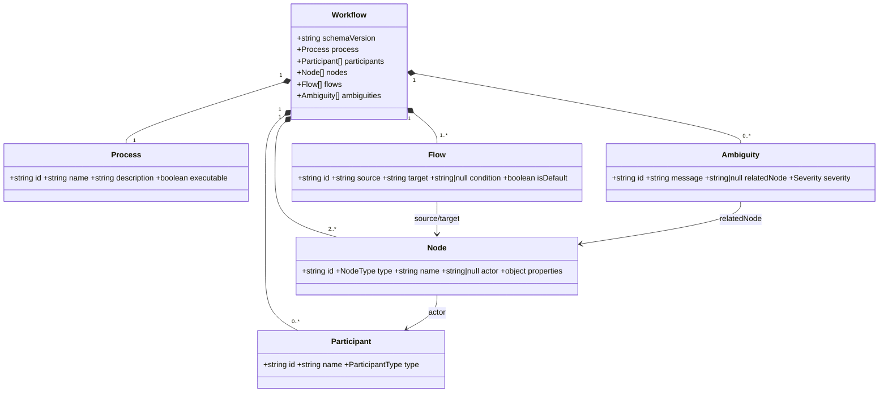

# Diagramme du modèle

```text
Workflow
├── schemaVersion
├── process : Process
├── participants : Participant [0..*]
├── nodes : Node [2..*]
├── flows : Flow [1..*]
└── ambiguities : Ambiguity [0..*]

Node.actor → Participant.id
Flow.source → Node.id
Flow.target → Node.id
Ambiguity.relatedNode → Node.id
```


